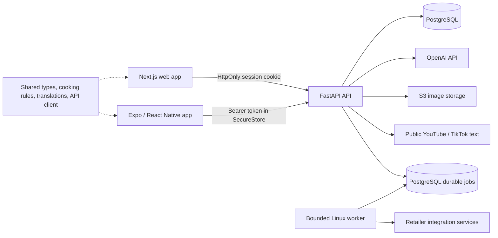

# Chef World architecture

Chef World turns supported public recipe text into an editable private recipe library, weekly meal plans, a shared cooking session across devices, and a grocery shopping workflow. Web and native clients share domain code while retaining platform-specific navigation, persistence, and interaction.

## System map

| Area | Responsibility | Main location |
| --- | --- | --- |
| Web | Authentication, recipe review/library, planner, cooking, shopping, account settings | `apps/web/app` |
| Mobile | Native counterparts, secure token storage, share extension, local cooking notifications | `apps/mobile/src` |
| Shared domain | Recipe/planner contracts, cooking transitions/queue helpers, grocery categories, translations, safe retailer handoff | `packages/shared/src` |
| Transport | Cookie/bearer API requests and structured failures | `packages/api-client/src` |
| Design system | Shared design tokens with web/native adapters | `packages/design-tokens`, client theme/components |
| API | Authentication, request validation, user ownership, operation admission | `backend/app/api` |
| Persistence | User-scoped SQL, atomic writes, active cooking state, shared product cache, AI counters | `backend/app/db` |
| External services | Text retrieval/extraction, grocery refinement, image storage, retailer services | `backend/app/{extract,refine,video_import}.py`, `backend/app/services` |
| Delivery | Schema migrations, build contexts, CI checks and digest-pinned deployment | `backend/alembic`, Dockerfiles, `.github/workflows`, `scripts` |

## Data and trust boundaries

Users own recipes and meal plans. Recipe writes enforce ownership atomically in PostgreSQL, and copying a shared recipe creates a separate owned record. Ordinary saves cannot change publication or copy provenance. Administrative and public-catalog capabilities come from configured, verified account UUIDs; email claims and client UI do not grant authority.

The public recipe catalog and optional friend-library visibility are distinct features. Enabling library sharing exposes the account's library to users who find it through email search. Recipe source text, image URLs, and AI output are untrusted inputs. Both platforms keep the draft review step before persistence; source links are validated before becoming navigable.

Browser credentials live in an HttpOnly cookie. Unsafe browser requests are checked against exact trusted origins. Native tokens live in SecureStore, and authenticated requests use bearer headers. All native API requests explicitly omit cookies, including login and registration, so the operating system's cookie jar cannot mix identities or interfere with origin checks. Client account changes invalidate account state; shopping caches are scoped to the authenticated account. Language and accessibility preferences are device preferences and survive logout. JWTs currently expire after seven days; centralized token revocation is a remaining account-security requirement.

## AI boundary

OpenAI is called only by the backend using a server credential. The repository does not automate a consumer ChatGPT session. A company-owned OpenAI project and service identity should fund production, with a separate development project. Credential ownership, billing access and spend limits require verification in the provider account; source code alone cannot establish them.

Extraction, optional step recovery, grocery refinement and tutorial estimates use a shared provider client. Operations have a total deadline, shared concurrency leases, an output cap and no automatic SDK retries. PostgreSQL caps accepted operations per account and globally using database time. Every paid call also reserves a conservative monetary allowance before contacting OpenAI; authoritative token usage reconciles it once, while unknown outcomes remain reserved. Dated model prices and account/app monetary allocations are required. The default AI allocation is zero until hosting and AI fit the owner's combined $150 monthly ceiling. Application enforcement does not control unrelated provider or hosting charges.

Admission transactions commit before provider work; read-only sessions close before external waits, including tutorial estimates, uploads and Instacart export. Video text retrieval runs in a separate process with cancellation and a parent-death/deadline watchdog. Logs exclude raw prompts, credentials and provider error bodies. Admin-only accounting exposes modeled usage, reserved cost and configured caps, not provider invoices.

Imports fail clearly when the provider is unconfigured. Refinement can preserve original ingredients and tutorial estimation can use local metadata rules. Missing video speech is not invented: YouTube uses public captions/description, while TikTok uses public post text. The retained upstream YouTube fallback can request the canonical public video's description through Jina Reader when direct access fails; it does not send private guidance or account credentials to Reader. Full arbitrary-video transcription remains a separate integration.

## State and concurrency

PostgreSQL owns the active cooking session. Cooking actions use row locks, step revisions and mutation IDs; expiry-updating reads take the same lock. Removing dishes preserves position uniqueness throughout the transaction. Devices can cache a validated session and replay queued step actions, but create/remove/finish actions require connectivity.

Planner day edits are serialized on each client and use server revisions to detect conflicting edits across devices. A conflict refreshes the authoritative day and asks the user to retry. Legacy writes without a revision retain compatibility and still increment the revision. Planner and shopping date ranges are bounded to 31 days. Cooking mutations retain their existing revision/mutation-ID protection. Shopping ingredient aggregation fetches needed owned recipes in a single query and counts repeated meal occurrences.

Retail results retain in-memory and shared persistent caches. In production, misses and warmer work enter a bounded PostgreSQL queue with deduplication, fenced ownership, capped retries and shared status. Separate Linux workers serialize retailer work globally; API replicas do not launch browsers. A missing worker yields a bounded retryable failure. Process-local mode remains for development only. Provider permission and live throughput remain separate qualification gates.

New recipe lists use signed cursor pages of summaries (default 40, maximum 100), server-side search/filtering and explicit detail fetches. Current web/mobile consumers use these routes. Deprecated array endpoints remain for older clients and are excluded from the bounded-work capacity statement until a minimum client version can be enforced. Database pools, statement/lock waits and rollout connection overlap are explicit settings; replica growth cannot create database capacity.

## Storage and delivery

Images are size- and signature-checked at the API. Shared hourly/daily admission and cumulative account/app byte/count reservations precede storage. Cumulative reservations include unattached images and ambiguous failures and never expire automatically, bounding new storage growth. This is intentionally conservative: authoritative inventory and confirmed cleanup are needed to reclaim quota. Historical objects still require an inventory/ownership migration before the counters describe total retained storage or comprehensive account deletion can be guaranteed. The backend stores exactly the validated bytes; signatures are not a full decoding or malware scan.

Backend and web Docker contexts exclude credentials and local artifacts. Production images use non-root users. Local Compose retains its development upload-permission override. The backend deployment script builds a committed archive and registers an immutable image digest. A single bounded, PostgreSQL-locked migration task from that same image must succeed before the API service update; API/worker startup does not run migrations. `/health` checks liveness and `/ready` checks database/schema readiness. Rollout checks verify revision, image digest and readiness. Infrastructure preparation is dry-run only and requires a complete estimate within $150; two API replicas do not make a single-AZ database highly available.

See the [capacity operating runbook](capacity-operations.md) for configuration, qualification gates and recovery. Implementation and local validation do not establish deployed capacity.

See the [engineering review](engineering-review-2026-09-14.md) for evidence, remaining release gates and operational setup, and the [data inventory](data-inventory.md) for storage, sharing and retention boundaries.
