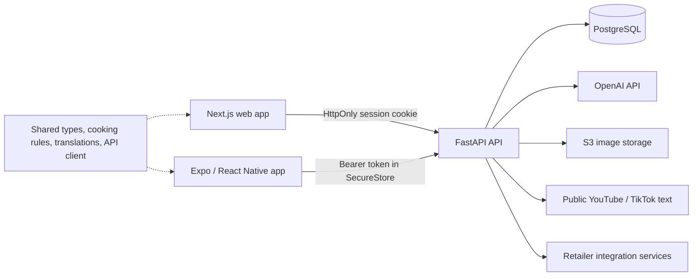

# Chef World architecture

Chef World turns supported public recipe text into an editable private recipe library, weekly meal plans, a shared cooking session across devices, and a grocery shopping workflow. Web and native clients share domain code while retaining platform-specific navigation, persistence, and interaction.

## System map

| Area | Responsibility | Main location |
| --- | --- | --- |
| Web | Authentication, recipe review/library, planner, cooking, shopping, account settings | `apps/web/app` |
| Mobile | Native counterparts, secure token storage, share extension, local cooking notifications | `apps/mobile/src` |
| Shared domain | Recipe/planner contracts, cooking transitions/queue helpers, grocery categories, translations, safe retailer handoff | `packages/shared/src` |
| Transport | Cookie/bearer API requests and structured failures | `packages/api-client/src` |
| Design system | Shared design tokens with web/native adapters | `packages/design-tokens`, client theme/components |
| API | Authentication, request validation, user ownership, operation admission | `backend/app/api` |
| Persistence | User-scoped SQL, atomic writes, active cooking state, shared product cache, AI counters | `backend/app/db` |
| External services | Text retrieval/extraction, grocery refinement, image storage, retailer services | `backend/app/{extract,refine,video_import}.py`, `backend/app/services` |
| Delivery | Schema migrations, build contexts, CI checks and digest-pinned deployment | `backend/alembic`, Dockerfiles, `.github/workflows`, `scripts` |

## Data and trust boundaries

Users own recipes and meal plans. Recipe writes enforce ownership atomically in PostgreSQL, and copying a shared recipe creates a separate owned record. Ordinary saves cannot change publication or copy provenance. Administrative and public-catalog capabilities come from configured, verified account UUIDs; email claims and client UI do not grant authority.

The public recipe catalog and optional friend-library visibility are distinct features. Enabling library sharing exposes the account's library to users who find it through email search. Recipe source text, image URLs, and AI output are untrusted inputs. Both platforms keep the draft review step before persistence; source links are validated before becoming navigable.

Browser credentials live in an HttpOnly cookie. Unsafe browser requests are checked against exact trusted origins. Native tokens live in SecureStore, and authenticated requests use bearer headers. All native API requests explicitly omit cookies, including login and registration, so the operating system's cookie jar cannot mix identities or interfere with origin checks. Client account changes invalidate account state; shopping caches are scoped to the authenticated account. Language and accessibility preferences are device preferences and survive logout. JWTs currently expire after seven days; centralized token revocation is a remaining account-security requirement.

## AI boundary

OpenAI is called only by the backend using a server credential. The repository does not automate a consumer ChatGPT session. A company-owned OpenAI project and service identity should fund production, with a separate development project. Credential ownership, billing access and spend limits require verification in the provider account; source code alone cannot establish them.

Extraction, optional step recovery, grocery refinement and tutorial estimates use a shared provider client. Calls have a deadline, output cap and no automatic SDK retries. A PostgreSQL reservation caps accepted operations per account and globally, using database time so replicas share the same allowance. Quota writes commit before provider work; read-only sessions close before stateless external waits, including tutorial estimates, uploads and Instacart export. Logs record operational metadata and token counts without raw prompts or provider error bodies. The operation counters do not calculate dollar charges.

Imports fail clearly when the provider is unconfigured. Refinement can preserve original ingredients and tutorial estimation can use local metadata rules. Missing video speech is not invented: YouTube uses public captions/description, while TikTok uses public post text. The retained upstream YouTube fallback can request the canonical public video's description through Jina Reader when direct access fails; it does not send private guidance or account credentials to Reader. Full arbitrary-video transcription remains a separate integration.

## State and concurrency

PostgreSQL owns the active cooking session. Cooking actions use row locks, step revisions and mutation IDs; expiry-updating reads take the same lock. Removing dishes preserves position uniqueness throughout the transaction. Devices can cache a validated session and replay queued step actions, but create/remove/finish actions require connectivity.

Planner day edits are serialized on each client so rapid edits do not overwrite their own optimistic state. Server-side revisions for simultaneous planner edits across devices remain future work. Shopping ingredient aggregation fetches the needed owned recipes in a single query and counts repeated meal occurrences.

Retail product results have in-memory and persistent caches. The existing Weee live lookup queue serializes work only within one backend process. Its background warmer is process-local and opportunistic. Horizontal scaling of that integration requires either permitted provider APIs or a dedicated/distributed worker; increasing API replicas alone is insufficient.

## Storage and delivery

Images are size- and signature-checked at the API. The backend writes exactly those bytes to S3 or local disk and returns the final URL. New S3 keys include an account identifier; historical objects need an ownership/retention migration before comprehensive account deletion can be guaranteed. Image signatures are not a full decoding or malware scan.

Backend and web Docker contexts exclude credentials and local artifacts. Production images use non-root users. The local Compose backend explicitly retains root inside its development container so existing host-mounted uploads remain writable; this override is for development only. The backend deployment script builds a committed source archive and registers an ECS revision pinned to an immutable digest; it checks the requested revision and running image after rollout. Database migrations still execute during container startup and should move to a controlled release job before larger-scale operation.

See the [engineering review](engineering-review-2026-09-14.md) for evidence, remaining release gates and operational setup, and the [data inventory](data-inventory.md) for storage, sharing and retention boundaries.
