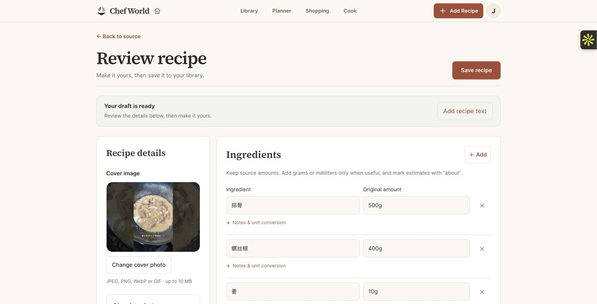

# Admin AI budget hotfix — September 30, 2026

The owner’s YouTube import failed because its Gemini reservation exceeded the ordinary account’s remaining USD 3 monthly allowance. The error was surfaced as “AI is temporarily unavailable.” Trusted `ADMIN_USER_IDS` accounts now use the remaining shared USD 29 monthly AI budget across metered text/video calls, consistent with the existing image policy. Ordinary accounts and catalog-editor-only accounts keep their USD 3 ceiling. Email never grants the exemption.

The atomic global ledger guard, modeled USD 30 hard ceiling, unknown-call reservations, request/concurrency limits and deadlines are unchanged. No ledger balance was reset or refunded. No schema change or new admin grant was made.

## Verified release

- Backend application source: `f56f0ad9add845eeaad120b8c8bbf91a0937bf5e`.
- API task: `cooking-backend:40`, one healthy running task, completed rollout.
- Immutable image: `sha256:e0c4af80834ee62ce1c92b96ce4bdea13886c4c3fe726447f9e0526c4f78d90c`.
- Production: `AI_MONTHLY_BUDGET_USD=29`, `AI_ACCOUNT_MONTHLY_BUDGET_USD=3`; trusted admins select the global allowance in code. `GEMINI_TIMEOUT_SECONDS=120` is preserved.
- Task configuration excluding image/account allowance, service configuration and retailer worker revision 2 match the pre-hotfix fingerprints. Authentication, admin UUID allowlist, other budgets and operational guards are preserved.
- Website runtime inputs match the existing YouTube/RedNote application release. No website or native deployment was made in this hotfix. The only intervening website-source difference is a browser-test correction.
- The temporary revision 39 raised the ordinary allowance to USD 4 while the final policy was prepared. Revision 40 restores USD 3 for ordinary users and applies the admin exemption. Emergency API rollback is revision 39, which restores that temporary USD 4 behavior rather than the final admin policy.

## Validation

The new real-ledger regression initially failed for the admin’s reservation, while the four denial cases passed. After the fix, all five passed, covering the admin exemption, regular and editor denial with rollback, empty admin allowlist and the shared USD 29 ceiling. Focused money/admin/import tests passed 132. Independent scoped review found no critical or important issues and independently passed the five new cases. The full backend suite passed **1,581 tests, 6 skipped**, with two existing dependency warnings, against a migrated disposable PostgreSQL database and usable browser runtime.

Fresh backend and web images built from the committed source. Their non-root runtimes passed health/readiness, import rendering, Chromium, media encode/decode, anonymous RedNote retrieval and trusted-admin policy checks. Local ECR publication stalled; a temporary, scoped AWS builder produced the final immutable image. That exact published image was pulled and passed the same runtime checks before release. The deployment’s locked migration completed before service update.

Both website import routes returned 200; API health/readiness returned 200, authenticated CORS passed on both domains, and unauthenticated import returned 401. The final bounded API/retailer log scan found no provider failures, monetary allowance denials, completeness audit failures, runtime errors, HTTP 5xx or signed-URL log leaks. The retailer log stream had no events in the checked window; this is not a new retailer workflow test.

## Real signed-in YouTube result

The existing owner account’s trusted admin capability was confirmed in the account menu. After all previous API workers were `STOPPED` and only revision 40 accepted traffic, the already-entered video [v0j_KkNJA4Q](https://www.youtube.com/watch?v=v0j_KkNJA4Q) was submitted through the production website’s Prepare draft flow.

At **05:54:46 UTC**, the website showed **Your draft is ready**, titled **虎皮青椒烧排骨**, with **15 ingredients and 11 editable steps**, including source links. The draft remains open for the user’s review; **Save recipe was not clicked**. This verifies real provider processing and the production draft flow, not the culinary accuracy of every generated amount or timing.

Machine-readable production, runtime, HTTP, log and live-draft evidence: [production-result.json](artifacts/admin-ai-budget/production-result.json). Temporary AWS builder/project/role/private source bucket/logs, local test containers, disposable database and owned Docker network were removed. The immutable release image and reviewable worktree remain.
