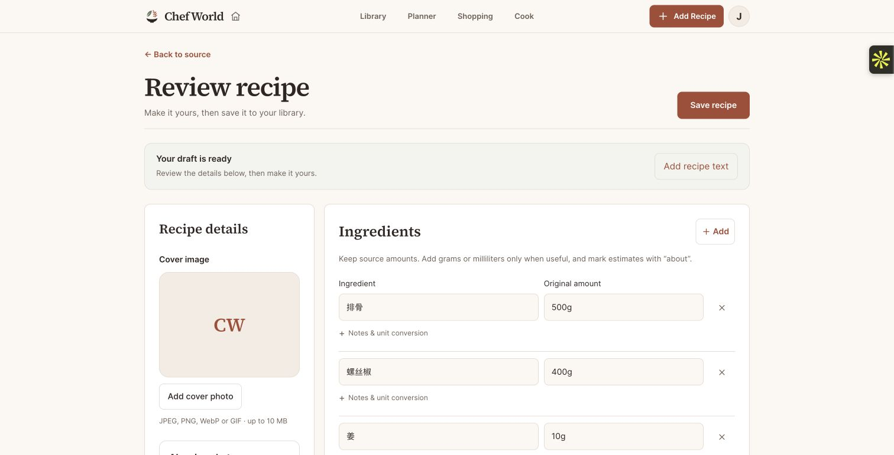

# RedNote and YouTube import release — September 30, 2026 UTC

Chef World now accepts YouTube and public RedNote (小红书) links, including complete copied RedNote share text. Public validation rejects TikTok and Douyin. Users prepare an editable draft and explicitly save after review. Anonymous RedNote retrieval uses curl-cffi; no paid video downloader, shared login, personal cookies or recurring proxy was added.

## Deployed identities

| Component | Verified release |
| --- | --- |
| Backend application source | `bef00f31f07d6708675458abd449bcf17b1c92ba` |
| Backend task | `cooking-backend:38` |
| Backend image | `sha256:96d4ef01f52afd4b1e32ab5e2c109f7810fe734d3dbbf30f70681a6b226e96ec` |
| Website application source | `893238e3435390c6a646b7543a25fec6aa456d10` |
| Website deployment | `dpl_Ev9vmCDkBfEwNLAmyZ2RT6k7EiiP` |
| Domains | https://chef-world.com and https://www.chef-world.com |
| Retailer worker | `cooking-store-worker:2`, unchanged |

The website application code did not change between the two source commits; the later commits change backend video preparation and safe diagnostics, the browser test helper and documentation. The production API has one healthy running task, the exact intended digest and a COMPLETED rollout. Service and task configuration fingerprints match the pre-release snapshots except for the intentional Gemini timeout increase from 35 to 120 seconds. The provider timeout remains clamped to the remaining AI admission deadline; other AI operations retain their 85-second overall deadline. Monetary limits and usage quotas remain unchanged. The deployment ran the locked migration before switching service traffic. There is no schema change.

Rollback references: API `cooking-backend:37` at the same `sha256:96d4ef01f52afd4b1e32ab5e2c109f7810fe734d3dbbf30f70681a6b226e96ec` with the earlier 35-second Gemini timeout; previous website `dpl_7hkpveh1BJuFHRXiAfKjEy9bPVBc`. Recheck current production state before another release.

## Verification

- Full final backend suite: **1,576 passed, 6 skipped**, including tutorial, source validation, import routes, timeouts and cancellation. Independent focused review: **29 passed**.
- Earlier release source unit suites: web **842**, shared **398**, mobile **409** passed, with relevant type checks. Frontend application code remains unchanged in the compression follow-up.
- Fresh backend and web images built from committed source. The exact cloud backend image ran as uid1001 at 0.5CPU/1GiB in an isolated container; Chromium, video encode/decode, real public RedNote retrieval, disposable migration, health and readiness passed. The local amd64 backend runtime used Docker emulation on this arm64 computer; separate timing evidence below ran on actual Fargate.
- Fresh web image runtime: **20/20 desktop/phone** controlled browser cases passed, covering full RedNote share text, title-field links, sign-in handoff, shared video, YouTube parsing, review/save and cancellation. Signed-out tests accept the correct login redirect while retaining the share payload. The helper establishes a controlling service worker before submission.
- Hosted/public website fixtures: **20/20 desktop/phone** passed. All **1,054** uploaded source files matched the committed website source. Initial post-promotion HTTP checks passed **26** route/asset/auth/CORS requests. Final backend release checks separately passed **7** page, health, readiness, authentication and CORS checks across both domains.
- Mocked browser cases prove controlled UI behavior; they do not prove real AI/provider output or physical-device OS sharing. The actual signed-in browser check is recorded separately below.

## Actual public video and production CPU timing

Source: `http://xhslink.com/o/QFcd665bHC`, public note `69eaf618000000001a035987`, title **好吃到跺脚的擂辣椒烧排骨‼️再来两碗大米饭**. The original public video is 102,576,558bytes, 155.934seconds, 720×1280 at30fps. Anonymous post retrieval and the public CDN download succeeded on AWS.

The first production draft attempt failed because the original veryfast compression exceeded its180second subprocess deadline. An isolated production-size Fargate task reproduced that failure at183.8seconds total. Ultrafast alone took169.7seconds total. The final profile bounds decoder/filter/encoder threads, retains audio and duration, uses up to720px width and 15fps, and completed preparation in **109.4seconds total** with a **27,063,292byte MP4** (below the30MiB analysis limit). An early live request on that profile still failed at about205seconds while old workers were retiring; it was not used as unique-release proof. Compression is now allowed260seconds within the existing310second download/preparation bound and420second job deadline. Sanitized diagnostics distinguish download, validation and preparation failures; HTTPX/HTTPCore URL-bearing logs are suppressed and three INFO-level privacy regressions cover download failure, preparation failure and success. An independent synthetic video check confirmed full decoding, duration, resolution,15fps and AAC audio preservation; the live recipe result establishes semantic extraction for this specific video.

Downloads remain bounded to150MiB on temporary disk, with up to10minute/4K input for local preparation. Overall preparation, redirect hosts, media types, process timeout and cancellation cleanup are bounded. RedNote jobs receive a seven-minute admission deadline; other AI operations retain their existing deadline, money limits and quotas.

On the sole revision37 worker, preparation succeeded in138.9seconds total with the same27,063,292byte output. Analysis then hit the existing35second Gemini timeout. Revision38 is a configuration-only release setting that provider timeout to120seconds, validated with the exact previously tested image. It reuses the same immutable application image and preserves the overall420second RedNote admission limit and85second deadline for other AI operations.

## Live recipe result

The first actual signed-in browser attempt reached **Review recipe** for **擂辣椒烧排骨**, with 15 ingredients and 13 steps, by04:34:07UTC after submission at04:29:26.847UTC. It included 500g 排骨 and 400g 螺丝椒. Because older workers were still retiring, this first result is UI/provider evidence rather than unique revision38 proof. Its original review screenshot is retained below; the browser was later used for another import and that work was left untouched. No Save action was performed by this release verification.

After revisions34–37 were fully STOPPED, a revision38 browser retry prepared the video successfully but was denied by the account's existing monetary allowance before provider analysis. No spending limit was raised or reservation refunded without usage evidence.

A temporary private QA account then exercised the actual production **POST /auth/login → POST /recipes/import-jobs → GET /recipes/import-jobs/{id}** workflow. The submitted source was the full Chinese title plus the original HTTP RedNote short link. The sole revision38 API worker returned **completed**, title **擂辣椒烧排骨**, **15 ingredients and 15 steps**, with 500g 排骨 and 400g 螺丝椒. Completion was observed within **194.0 seconds after 202 acceptance**. The result preserves the sear/braise 40 minutes/tiger-skin pepper/finish order and remains an editable draft; quantities and working-time estimates need user review.

Verification independently confirmed **zero library recipes** for that test account. The temporary account and its queued draft were removed after the response was recorded. The normal global/account monetary caps, usage quotas, production authentication settings and provider accounting remained in force. No verification email or other outbound message was sent, and no credentials were printed or retained. The cost ledger retains charged usage rather than refunding verification calls.

Sanitized final production result: [production-result.json](artifacts/rednote-youtube-import/production-result.json).

The final ten-minute API/retailer-worker log window (05:00:04–05:10:04UTC) had zero error/HTTP5xx/preparation-failure/signed-URL-log matches. This bounded check is separate from the earlier account allowance denial and is not a guarantee about later provider availability.

## Limits and cleanup

Public RedNote access can still be restricted by the platform. Genuine sign-in/private-post requirements use the existing upload-video or pasted-text fallback. A successful public post does not guarantee every RedNote link. Existing recipe-analysis usage/quota still applies; the retrieval method adds no paid downloader.

No native binary or OTA update was published. Desktop/phone browser fixtures are not physical-device OS-share evidence. Pasting a copied link/share text works on the website; installed-app share targets remain dependent on browser/OS support.

Three temporary cloud builders, their private source buckets, build-only roles and build logs were removed after receipts were saved. All six isolated Fargate diagnostic tasks exited and stopped, including two read-only budget queries and the public API verification client. The first read-only query failed on diagnostic number formatting without mutating production data; its corrected repeat and the public API client exited 0. The release-owned local API/web/database containers and isolated Docker network were removed. Retired API revisions34,35,36 and37 were independently confirmed fully STOPPED; a completed service rollout alone can leave an older recipe worker active during load-balancer draining. Revision37 stopped at04:54:29UTC. The final real-provider verification started at04:54:43.868UTC, after that full-stop gate; only revision38 was serving traffic. The primary dirty checkout was left untouched. No image prune, unrelated service change, native release, library save or public recipe modification was performed.

Sanitized release receipts: `/private/tmp/chef-rednote-release-20260930`, including `backend-safe-deadline-final.log`, `browser-fresh-deadline.log`, `cloud-deadline-image.json`, `cloud-deadline-runtime.log`, `backend-analysis-deploy.log`, `production-analysis-before.json`, `production-analysis-after.json`, `analysis-config-runtime.log`, `public-analysis-http.json`, `retired-analysis-api-check.json`, `live-analysis-target-proof.json`, `live-analysis-rednote-stage.json`, and `post-analysis-log-check.json`. Earlier compression-release receipts remain available for the recorded history. Private browser state, bypass URLs and traces are not linked or published.
